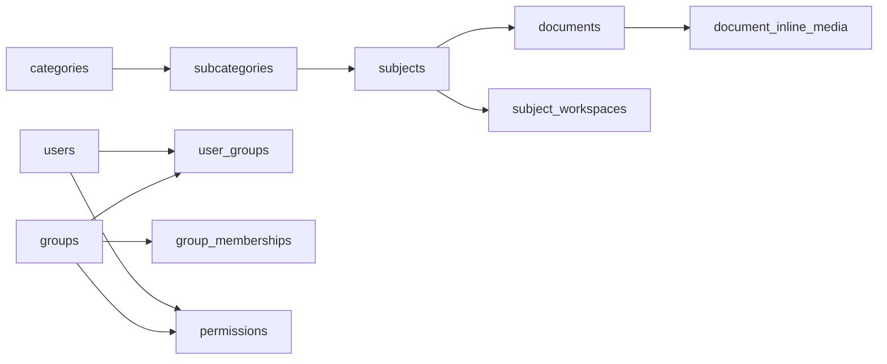

# Banco de dados do DocGov

[Documentação](../docs/README.md) · [Arquitetura](../docs/referencia/arquitetura.md) · [Instalação e operação](../docs/operacao/instalacao-e-operacao.md)

A aplicação usa PostgreSQL via PDO. A conexão é configurada em `config/db.php`.

## Arquivos e responsabilidades

| Arquivo/diretório | Finalidade |
| --- | --- |
| [schema.sql](schema.sql) | Estrutura de uma base nova; contém limpeza com `DROP TABLE` |
| [migrations/](migrations/) | Evolução incremental de instalações existentes |
| [seed.sql](seed.sql) | Dados e contas de demonstração para desenvolvimento |
| [migrate_legacy_data.php](migrate_legacy_data.php) | Utilitário de dados legados/demonstração; exige revisão antes do uso |
| [PERMISSIONS_ARCHITECTURE.md](PERMISSIONS_ARCHITECTURE.md) | Especificação de origem do modelo de acesso, incluindo contexto histórico |
| [CAPABILITIES_MATRIX.md](CAPABILITIES_MATRIX.md) | Matriz de operações por nível de acesso ao conteúdo |

O schema declara PostgreSQL 14+. O modelo atual é mais amplo que a hierarquia inicial de documentos.

## Modelo de dados

| Área | Tabelas principais |
| --- | --- |
| Identidade | `users` |
| Hierarquia | `categories`, `subcategories`, `subjects` |
| Documentos e mídia | `documents`, `document_sections`, `document_inline_media` |
| Workflow documental | `document_workflow_history` |
| Processo do assunto | `subject_workspaces`, `subject_workspace_history` |
| Tags | `tags`, `tag_aliases`, `document_tags` |
| Equipes | `groups`, `user_groups`, `group_memberships` |
| Permissões | `permissions`, `permission_audit` |
| Capacidades globais | `group_system_capabilities`, `system_capability_audit` |
| Preferências e operação | `favorites`, `notifications`, `system_settings`, `usage_audit_events` |



O diagrama mostra vínculos principais; consulte o DDL para chaves, cardinalidades, constraints, índices e triggers. Os binários ficam no sistema de arquivos; o banco mantém os vínculos e metadados. Banco e arquivos precisam permanecer compatíveis em um backup/restauro.

## Criar uma base nova

Crie uma base vazia com uma conta de instalação apropriada. Exemplo para desenvolvimento local, a partir da raiz:

```powershell
createdb -h 127.0.0.1 -U postgres docgov_dev
psql -h 127.0.0.1 -U postgres -d docgov_dev -v ON_ERROR_STOP=1 -f database/schema.sql
```

Confirme o destino antes de aplicar: `schema.sql` contém comandos de remoção de tabelas. Configure a conta da aplicação e seus privilégios conforme o ambiente.

O seed é opcional e contém contas/dados de demonstração. Leia seu conteúdo antes de aplicá-lo em uma base descartável; não o use como carga automática de produção ou procedimento de criação de administrador.

## Atualizar uma base existente

1. Registre a versão de código/schema e faça backup restaurável do banco e dos arquivos.
2. Compare a estrutura existente com as migrações exigidas pelo código de destino.
3. Identifique dependências e aplique somente as migrações pendentes, com interrupção em erro.
4. Valide a estrutura resultante e a regressão da funcionalidade.
5. Registre arquivos executados, data, resultado e plano de recuperação.

Não reaplique o schema nem execute indiscriminadamente todos os SQLs por ordem alfabética. Há numerações históricas repetidas; `003_resource_permissions.sql` é um marcador legado e `003_permissions_model.sql` define o modelo consolidado.

O executor [scratch/run_migrations.php](../scratch/run_migrations.php) contém uma lista explícita até **029** e transação por arquivo. Ele reaplica a lista; não mantém uma tabela de versões já executadas. Seu uso exige revisão do estado inicial e não substitui a identificação de pendências.

## Migrações recentes

| Migração | Efeito | Procedimento |
| --- | --- | --- |
| [026_subject_visibility.sql](migrations/026_subject_visibility.sql) | Visibilidade pública/privada por assunto | [Assuntos públicos e privados](../docs/referencia/assuntos-publicos-privados.md) |
| [027_nested_groups.sql](migrations/027_nested_groups.sql) | Vínculos entre equipes e proteção contra ciclos | [Grupos aninhados](../docs/referencia/grupos-aninhados.md) |
| [028_ad_domain_identity.sql](migrations/028_ad_domain_identity.sql) | Unicidade de login por domínio e de contas locais | [Identidades AD](../docs/referencia/identidades-ad-por-dominio.md) |
| [029_api_clients.sql](migrations/029_api_clients.sql) | Chaves da API de integração (`api_clients`) e janelas de limite (`api_client_rate_windows`); idempotente, só cria tabelas | [API de integração](../docs/referencia/api-integracao.md#implantação) |

A migração 028 cria os índices antes de remover `users_username_key`; não renomeia contas nem transfere permissões. E-mail e GUID continuam protegidos contra conflitos. Execute-a na transação descrita no procedimento da funcionalidade.

Não há runner geral de rollback identificado. Retornar somente o código pode ser insuficiente após uma mudança de schema; o procedimento de recuperação deve considerar banco e arquivos.

## Fontes relacionadas

- [Configuração da conexão e precedência](../docs/referencia/configuracao.md).
- [Permissões e capacidades atuais](../docs/referencia/permissoes.md).
- [Testes e isolamento do banco](../docs/desenvolvimento/testes.md).
